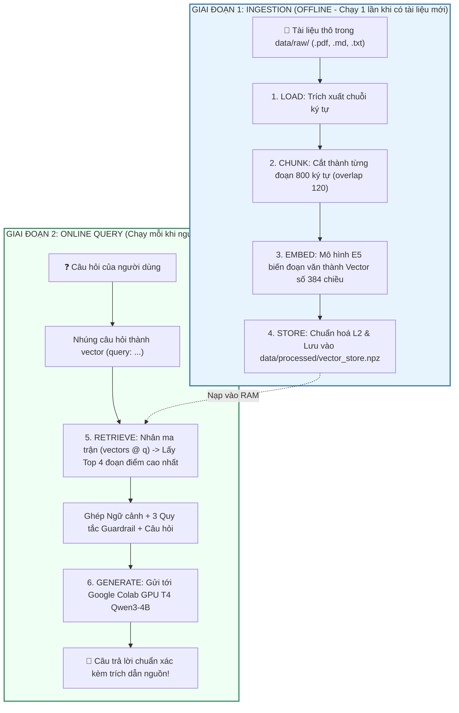

# 🎓 GIÁO TRÌNH NHẬP MÔN: RAG TỪ ZERO ĐẾN THỰC CHIẾN
> *Tài liệu hướng dẫn trực quan, dễ hiểu từng bước dành cho người mới bắt đầu học AI & RAG.*

---

## 🧭 MỤC LỤC BÀI HỌC
1. [Khái niệm cốt lõi: RAG là gì?](#1-khái-niệm-cốt-lõi-rag-là-gì)
2. [Tại sao cần RAG? (Ẩn dụ "Thi đóng sách" vs "Thi mở sách")](#2-tại-sao-cần-rag)
3. [Bản đồ kiến trúc: 2 Giai đoạn & 6 Bước kỹ thuật](#3-bản-đồ-kiến-trúc-hệ-thống)
4. [Mổ xẻ chi tiết 6 bước kỹ thuật qua từng dòng code](#4-mổ-xẻ-chi-tiết-6-bước-kỹ-thuật)
   - [Bước 1: Load (Đọc tài liệu)](#bước-1-load---nạp-tài-liệu-thô)
   - [Bước 2: Chunk (Băm nhỏ & Kỹ thuật Overlap)](#bước-2-chunk---băm-nhỏ-văn-bản--nghệ-thuật-overlap)
   - [Bước 3: Embed (Biến chữ thành tọa độ không gian)](#bước-3-embed---biến-ngôn-ngữ-thành-tọa-độ-vector)
   - [Bước 4: Store (Toán học lưu trữ ma trận với NumPy)](#bước-4-store---toán-học-lưu-trữ-vector-với-numpy)
   - [Bước 5: Retrieve (Tìm kiếm ngữ nghĩa theo Cosine Similarity)](#bước-5-retrieve---truy-xuất-ngữ-nghĩa)
   - [Bước 6: Generate (Kỷ luật Guardrail & Gọi LLM Colab)](#bước-6-generate---kỷ-luật-guardrail--gọi-llm-colab)
5. [Cầm tay chỉ việc: Tự tay chạy và quan sát hệ thống](#5-cầm-tay-chỉ-việc-thực-hành)
6. [Bộ câu hỏi ôn tập & Mẹo nâng cao](#6-ôn-tập--mẹo-nâng-cao)

---

## 1. Khái Niệm Cốt Lõi: RAG Là Gì?

**RAG** là viết tắt của **Retrieval-Augmented Generation**, dịch sang tiếng Việt nghĩa là:
> **"Tạo sinh Tăng cường bằng Truy xuất"**

Hãy tách cụm từ này thành 2 vế để hiểu bản chất:
1. **Retrieval (Truy xuất / Tìm kiếm):** Đi tìm những mẩu thông tin, đoạn văn bản liên quan nhất từ kho tài liệu của bạn (file PDF, Word, Markdown, báo cáo nội bộ...).
2. **Generation (Tạo sinh / Sinh văn bản):** Dùng mô hình ngôn ngữ lớn (LLM như Qwen, ChatGPT, Gemini...) đọc các mẩu thông tin vừa tìm được rồi viết thành câu trả lời hoàn chỉnh, mạch lạc và chuẩn ngữ pháp.

👉 **Tóm lại một câu:** *RAG là kỹ thuật giúp AI tìm đúng tài liệu trước rồi mới mở miệng trả lời.*

---

## 2. Tại Sao Cần RAG?

### Phép Ẩn Dụ Kinh Điển: "Thi Đóng Sách" vs "Thi Mở Sách"

| Đặc điểm | LLM Truyền Thống (Không có RAG) | Hệ Thống RAG (Có tra cứu tài liệu) |
| :--- | :--- | :--- |
| **Hình tượng** | Học sinh đi thi **ĐÓNG SÁCH** 📕 | Học sinh đi thi **MỞ SÁCH** 📖 |
| **Cách làm** | Chỉ dựa vào những gì nhớ được khi "ôn thi" (quá trình pre-training). | Khi giám thị phát đề, lật đúng trang sách chứa câu trả lời rồi chép lại có chọn lọc. |
| **Khi gặp kiến thức lạ** | Dễ bịa đặt, nói xạo một cách tự tin (**Ảo giác - Hallucination**). | Đọc không thấy trong sách sẽ thật thà nói: *"Tài liệu không đề cập"*. |
| **Dữ liệu mới hôm nay** | Không biết (vì dữ liệu bị khóa tại thời điểm huấn luyện model). | Biết ngay lập tức, chỉ cần thả tài liệu mới vào thư mục. |
| **Trích dẫn nguồn** | Không biết lấy thông tin từ sách nào, trang mấy. | Trích dẫn chính xác: `[nguồn: bao_cao_tai_chinh.pdf, dòng 45]`. |

### So Sánh: RAG vs Fine-Tuning (Huấn Luyện Lại Model)

Nhiều người mới học thường nghĩ: *"Muốn AI biết dữ liệu của công ty tôi thì phải huấn luyện lại (fine-tune) model chứ?"*  
**Thực tế hoàn toàn ngược lại:**

| Tiêu chí | Huấn Luyện Lại (Fine-Tuning) | Dùng RAG |
| :--- | :--- | :--- |
| **Chi phí & GPU** | Rất đắt, cần GPU khủng (A100, H100) chạy nhiều giờ/ngày. | Siêu rẻ, chạy miễn phí trên máy tính thường hoặc Google Colab T4. |
| **Thời gian cập nhật** | Mỗi lần sửa tài liệu lại phải train lại từ đầu. | Tức thì (vài giây): nạp file mới là xong ngay. |
| **Độ chính xác chi tiết** | Dễ nhớ sai số liệu, ngày tháng, tên riêng. | Chính xác 100% vì nhìn thẳng vào văn bản gốc để trích xuất. |
| **Bảo mật dữ liệu** | Khó thu hồi dữ liệu đã "nướng" vào trọng số model. | Dễ dàng xóa file hoặc phân quyền ai được đọc file nào. |

---

## 3. Bản Đồ Kiến Trúc Hệ Thống

Toàn bộ quy trình RAG được chia làm **2 GIAI ĐOẠN ĐỘC LẬP**:



---

### 📂 5 Khu Vực Thư Mục Gốc (Root Folders) — "Mỗi Khu Vực Một Trách Nhiệm"
*(Theo đúng bài giảng Tập 01 / 04 của video hướng dẫn)*

| Thư mục | Trách nhiệm theo video | Vị trí trong dự án của bạn |
| :--- | :--- | :--- |
| **`/data`** | Tài liệu và dữ liệu sau xử lý. | [data/raw/](file:///home/trietbui/Documents/HK5/Local AI/data/raw) & [data/processed/](file:///home/trietbui/Documents/HK5/Local AI/data/processed) |
| **`/src`** | Code RAG chính, có thể tái dùng. | [src/rag/](file:///home/trietbui/Documents/HK5/Local AI/src/rag) |
| **`/scripts`** | Lệnh chạy ingest và hỏi đáp dòng lệnh. | [scripts/ingest.py](file:///home/trietbui/Documents/HK5/Local AI/scripts/ingest.py) & [scripts/ask.py](file:///home/trietbui/Documents/HK5/Local AI/scripts/ask.py) |
| **`/tests`** | Kiểm tra code còn chạy đúng (smoke test). | [tests/test_smoke.py](file:///home/trietbui/Documents/HK5/Local AI/tests/test_smoke.py) & [tests/test_pipeline.py](file:///home/trietbui/Documents/HK5/Local AI/tests/test_pipeline.py) |
| **`/notebooks`** | Nơi thử nghiệm, không phải core. | [notebooks/01_rag_tu_zero_demo.ipynb](file:///home/trietbui/Documents/HK5/Local AI/notebooks/01_rag_tu_zero_demo.ipynb) |

---

## 4. Mổ Xẻ Chi Tiết 6 Bước Kỹ Thuật

Hãy cùng lật mở từng file code trong dự án `Local AI` để thấy cách toán học và lập trình kết hợp với nhau.

---

### Bước 1: LOAD - Nạp Tài Liệu Thô
📂 *File mã nguồn:* [src/rag/loader.py](file:///home/trietbui/Documents/HK5/Local AI/src/rag/loader.py)

#### Vấn đề:
Tài liệu của bạn có thể là Markdown `.md`, văn bản thuần `.txt`, hoặc file `.pdf`. Bạn cần một hàm duyệt qua toàn bộ thư mục [data/raw/](file:///home/trietbui/Documents/HK5/Local AI/data/raw) và đưa tất cả về một cấu trúc dữ liệu chuẩn:
```python
@dataclass
class Document:
    source: str  # Tên file gốc (ví dụ: 'bao_cao.pdf')
    text: str    # Toàn bộ nội dung chữ bên trong
```

#### Tại sao PDF lại khó đọc hơn file text?
File PDF không lưu văn bản theo dòng như Notepad; nó lưu các đối tượng đồ họa đặt tại các tọa độ $(x, y)$. Trong [src/rag/loader.py](file:///home/trietbui/Documents/HK5/Local AI/src/rag/loader.py), ta xây dựng cơ chế 2 lớp:
1. Thử dùng thư viện Python `pypdf` trích xuất text từng trang.
2. Nếu gặp lỗi, tự động gọi tiện ích hệ thống `pdftotext` của Linux (Poppler Utils) làm phương án dự phòng.

---

### Bước 2: CHUNK - Băm Nhỏ Văn Bản & Nghệ Thuật Overlap
📂 *File mã nguồn:* [src/rag/chunker.py](file:///home/trietbui/Documents/HK5/Local AI/src/rag/chunker.py)

#### Câu hỏi lớn: Tại sao phải băm nhỏ? Sao không nhét cả cuốn sách vào AI?
1. **Giới hạn Context Window:** Mô hình LLM có giới hạn độ dài ngữ cảnh (ví dụ 2048 token).
2. **Hiện tượng "Lost in the Middle":** Khi đọc một văn bản quá dài, AI thường chỉ nhớ đoạn đầu và đoạn cuối, hoàn toàn quên mất các chi tiết ở giữa.
3. **Độ tập trung của Vector:** Một đoạn văn ngắn (800 ký tự) sẽ có ý nghĩa ngữ nghĩa rõ ràng, giúp việc tìm kiếm vector chính xác hơn rất nhiều so với một đoạn văn dài 10.000 từ chứa hàng chục chủ đề lẫn lộn.

#### Kỹ thuật Overlap (Chồng lấn) là gì?
Nếu bạn cắt thẳng một nhát ở ký tự thứ 800, điều gì xảy ra nếu nhát cắt rơi đúng vào giữa một câu quan trọng?
> *...Công ty quyết định sa thải giám đốc điều hành* **[CẮT]** *vào ngày hôm qua vì vi phạm đạo đức...*

Đoạn 1 sẽ bị mất đuôi, còn Đoạn 2 đọc vào sẽ không hiểu ai bị sa thải!  
👉 **Giải pháp:** Cắt thụt lùi lại một đoạn (`overlap = 120` ký tự).

```text
Văn bản gốc:  [========================================================================]
Chunk 1:      [---------- 800 ký tự ----------]
Chunk 2:                         [=== 120 ===][---------- 800 ký tự ----------]
                                  ^ Vùng chồng lấn (overlap) giữ nguyên ngữ cảnh nối tiếp
```

Trong [src/rag/chunker.py](file:///home/trietbui/Documents/HK5/Local AI/src/rag/chunker.py):
```python
step = chunk_size - chunk_overlap  # 800 - 120 = 680 ký tự mỗi bước nhảy
for start in range(0, len(text), step):
    piece = text[start : start + chunk_size]
    # Thu được Chunk độc lập giữ trọn vẹn ngữ nghĩa
```

---

### Bước 3: EMBED - Biến Ngôn Ngữ Thành Tọa Độ Vector
📂 *File mã nguồn:* [src/rag/embeddings.py](file:///home/trietbui/Documents/HK5/Local AI/src/rag/embeddings.py)

#### Bản chất của Embedding:
Máy tính không biết từ *"con mèo"*, *"vua"* hay *"trí tuệ nhân tạo"* có nghĩa là gì.  
Mô hình Embedding là một mạng nơ-ron nhận vào một chuỗi chữ và biến nó thành một **mảng số thực (vector)** nằm trong không gian đa chiều.

Ví dụ mô hình `intfloat/multilingual-e5-small` biến mỗi đoạn văn thành một vector 384 chiều:
$$\vec{v} = [0.042, -0.128, 0.851, ..., -0.019]$$

**Đặc tính kỳ diệu:** Hai câu có ý nghĩa tương tự nhau sẽ được biến thành hai vector nằm **gần nhau** trong không gian, dù chúng dùng từ ngữ khác nhau:
* Câu A: *"Hôm nay trời đổ mưa lớn"*
* Câu B: *"Thời tiết mưa gió bão bùng"*
👉 *Khoảng cách góc giữa Vector A và Vector B cực kỳ nhỏ!*

#### Bí Mật Dòng Model Họ E5 (Prefix query/passage):
Mô hình E5 được huấn luyện với quy ước bất đối xứng:
* Khi lưu tài liệu vào kho: Thêm tiền tố `"passage: "` &rarr; ví dụ: `"passage: RAG là kỹ thuật..."`
* Khi đặt câu hỏi tìm kiếm: Thêm tiền tố `"query: "` &rarr; ví dụ: `"query: RAG hoạt động ra sao?"`

Quy ước này giúp mô hình nhận biết đâu là câu hỏi và đâu là câu trả lời để kéo hai vector lại gần nhau hơn trong không gian toán học!

---

### Bước 4: STORE - Toán Học Lưu Trữ Vector Với NumPy
📂 *File mã nguồn:* [src/rag/vector_store.py](file:///home/trietbui/Documents/HK5/Local AI/src/rag/vector_store.py)

Nhiều người nghĩ xây dựng Vector Database là điều gì đó rất huyền bí và phức tạp. Nhưng trong video này, chúng ta viết một Vector Store **thuần túy bằng thư viện NumPy** chỉ với vài chục dòng code!

#### Công thức Cosine Similarity:
Độ tương đồng ngữ nghĩa giữa câu hỏi $\vec{q}$ và đoạn văn $\vec{v}$ được đo bằng $\cos(\theta)$ giữa hai vector:
$$\cos(\theta) = \frac{\vec{v} \cdot \vec{q}}{\|\vec{v}\| \times \|\vec{q}\|}$$

* $\cos = 1$: Hai vector cùng hướng &rarr; Ý nghĩa hoàn toàn giống nhau.
* $\cos = 0$: Hai vector vuông góc &rarr; Không liên quan gì đến nhau.
* $\cos = -1$: Hai vector ngược hướng &rarr; Trái nghĩa.

#### Mẹo Toán Học Cực Đỉnh (L2 Normalization):
Nếu ta chia mỗi vector cho độ dài của chính nó ($\|\vec{v}\| = 1$), thì mẫu số $\|\vec{v}\| \times \|\vec{q}\| = 1 \times 1 = 1$.  
Khi đó:
$$\cos(\theta) = \vec{v} \cdot \vec{q} \quad \text{(Chỉ còn lại tích vô hướng - Dot Product!)}$$

Nhờ đó, việc so khớp câu hỏi với $N$ đoạn văn bản trong kho dữ liệu được tính toán trong **1 phần nghìn giây** chỉ bằng **một phép nhân ma trận duy nhất**:
```python
scores = self._vectors @ q  # Ma trận (N, 384) nhân vector (384,) -> Mảng điểm (N,)
```

#### Sắp xếp bằng `np.argsort`:
```python
top_idx = np.argsort(-scores)[:top_k]  # Lấy chỉ số của 4 đoạn có điểm số cao nhất
```

#### Lưu trữ bền vững trên đĩa:
* File `data/processed/vector_store.npz`: Lưu ma trận số thực dạng nhị phân siêu nhẹ.
* File `data/processed/vector_store.meta.json`: Lưu danh sách văn bản và tên file nguồn.

---

### Bước 5: RETRIEVE - Truy Xuất Ngữ Nghĩa

Khi người dùng hỏi: *"Muốn model biết dữ liệu mới mà không fine-tune thì làm gì?"*
1. Nhúng câu hỏi thành vector $\vec{q}$ (384 chiều).
2. Chuẩn hoá $\vec{q}$ về độ dài 1.
3. Nhân ma trận `scores = vectors @ q`.
4. Bốc ra 4 đoạn có điểm tương đồng cao nhất.

Ví dụ kết quả thực tế trên máy của bạn vừa chạy:
* Đoạn 1: `02-embedding-va-vector-store.md` (Điểm tương đồng: **0.898**)
* Đoạn 2: `01-rag-la-gi.md` (Điểm tương đồng: **0.867**)

---

### Bước 6: GENERATE - Kỷ Luật Guardrail & Gọi LLM Colab
📂 *File mã nguồn:* [src/rag/prompts.py](file:///home/trietbui/Documents/HK5/Local AI/src/rag/prompts.py) & [src/rag/llm.py](file:///home/trietbui/Documents/HK5/Local AI/src/rag/llm.py)

Sau khi có 4 đoạn trích dẫn hay nhất, làm sao để bắt AI trả lời mà **không được bịa đặt**?

#### 3 Quy Tắc "Thiết Quân Luật" (System Guardrails):
Trong [src/rag/prompts.py](file:///home/trietbui/Documents/HK5/Local AI/src/rag/prompts.py), chúng ta thiết lập chỉ dẫn hệ thống:
```text
1. BẮT BUỘC chỉ trả lời dựa trên phần NGỮ CẢNH được cung cấp.
2. NẾU NGỮ CẢNH KHÔNG CÓ THÔNG TIN, hãy nói rõ là không tìm thấy trong tài liệu,
   TUYỆT ĐỐI KHÔNG BỊA ĐẶT.
3. Luôn trích dẫn nguồn theo dạng [nguồn: tên_file].
```

#### Cấu Trúc Khung Prompt Gửi Cho AI:
```text
NGỮ CẢNH:
[1] (nguồn: 01-rag-la-gi.md)
RAG là kỹ thuật giúp mở rộng kiến thức của mô hình...

[2] (nguồn: 02-embedding-va-vector-store.md)
Embedding biến chữ thành vector để tính toán tương đồng...

CÂU HỎI: RAG là gì và gồm mấy bước?

Hãy trả lời câu hỏi dựa trên NGỮ CẢNH ở trên.
```

#### Bắn Sang Google Colab GPU T4:
Lớp [ColabQwenLLM](file:///home/trietbui/Documents/HK5/Local AI/src/rag/llm.py) đóng gói toàn bộ prompt trên thành request gửi qua Gradio API tới mô hình **Qwen3-4B** đang nằm trên GPU Tesla T4 của bạn. Qwen3-4B đọc ngữ cảnh, tổng hợp lại và trả lời người dùng.

---

## 5. Cầm Tay Chỉ Việc: Thực Hành

Bây giờ bạn hãy tự mình trải nghiệm toàn bộ quy trình này bằng dòng lệnh:

### 🧪 Bài Thực Hành 1: Thêm một tài liệu mới vào kho

1. Tạo một file mới tại: `data/raw/ai-agent.md` với nội dung:
```markdown
# Khái niệm AI Agent
AI Agent là một hệ thống trí tuệ nhân tạo có khả năng tự chủ đưa ra quyết định, 
lập kế hoạch và sử dụng các công cụ (Tools/Skills) bên ngoài để hoàn thành mục tiêu.
Khác với Chatbot thụ động chỉ trả lời câu hỏi, Agent có thể tự động gọi hàm tìm kiếm,
tính toán số liệu và gửi email báo cáo cho người dùng.
```

2. Chạy lệnh nạp tài liệu (Offline Ingestion):
```bash
python scripts/ingest.py
```
*Quan sát:* Hệ thống sẽ tự động đọc file mới, băm nhỏ, tạo vector embedding bằng mô hình E5 và ghi đè vào file `vector_store.npz`.

---

### 🧪 Bài Thực Hành 2: Đặt câu hỏi kiểm tra

1. Mở terminal và chạy:
```bash
python scripts/ask.py "AI Agent khác Chatbot thụ động ở điểm nào?"
```

*Quan sát kết quả:*
```text
🤖 Trả lời:
Dựa trên tài liệu [nguồn: ai-agent.md], điểm khác biệt giữa AI Agent và Chatbot thụ động là:
AI Agent có khả năng tự chủ đưa ra quyết định, lập kế hoạch và sử dụng các công cụ 
(Tools/Skills) bên ngoài để hoàn thành mục tiêu, trong khi Chatbot chỉ trả lời thụ động...

📚 Nguồn tham khảo (đoạn liên quan nhất):
  [1] ai-agent.md  (điểm tương đồng: 0.912)
```

---

### 🧪 Bài Thực Hành 3: Thử thách "Đánh đố AI" để kiểm tra tính năng Chống Ảo Giác

Hãy thử hỏi một câu **hoàn toàn không có** trong bất kỳ tài liệu nào của bạn:
```bash
python scripts/ask.py "Công ty VinFast thành lập vào năm nào?"
```

*Quan sát kết quả:*
Nhờ có 3 quy tắc Guardrail trong [src/rag/prompts.py](file:///home/trietbui/Documents/HK5/Local AI/src/rag/prompts.py), mô hình sẽ trả lời:
> *"Tôi không tìm thấy thông tin về năm thành lập của công ty VinFast trong các tài liệu được cung cấp."*

👉 **AI đã không còn tự ý bịa đặt thông tin bừa bãi nữa!**

---

## 6. Ôn Tập & Mẹo Nâng Cao

### Tóm Tắt 4 Khái Niệm Quan Trọng Nhất Cần Nhớ:
1. **RAG** = Tìm kiếm tài liệu liên quan + Đưa vào Prompt cho LLM trả lời.
2. **Chunking** = Cắt nhỏ văn bản (800 ký tự) kèm khoảng đệm gối đầu (120 ký tự overlap) để không bị đứt câu.
3. **Embedding** = Biến câu văn thành vector số để so sánh độ tương đồng ngữ nghĩa.
4. **Guardrail** = Luật cấm LLM bịa đặt khi tài liệu không có thông tin.

### Các Kỹ Thuật Nâng Cao Trong Thực Tế Doanh Nghiệp (Advanced RAG):
Khi hệ thống của bạn mở rộng lên hàng triệu tài liệu, bạn có thể áp dụng thêm:
* **Hybrid Search (Tìm kiếm lai):** Kết hợp thuật toán từ khóa truyền thống (BM25) cùng với vector ngữ nghĩa để không bị sót các mã hiệu, số hiệu sản phẩm chính xác.
* **Re-ranking (Xếp hạng lại):** Dùng một mô hình chuyên dụng Cross-Encoder để chấm điểm lại 20 đoạn văn bản ban đầu, chỉ chọn lọc ra 3 đoạn xuất sắc nhất nạp vào LLM.
* **Semantic Chunking:** Thay vì cắt theo số ký tự cố định, thuật toán sẽ tự phát hiện khi nào đổi đoạn văn hoặc đổi chủ đề để cắt đúng ngữ cảnh tự nhiên.

---
*Chúc mừng bạn đã hoàn thành giáo trình RAG Từ Zero! Bây giờ bạn đã nắm vững toàn bộ cơ chế hoạt động của một hệ thống RAG hiện đại.*
